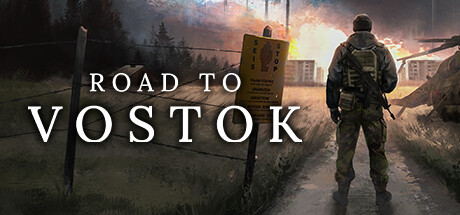

**Road to Vostok by Antti Aksela (Early Access 2024) is a hardcore solo survival shooter set on the Finnish-Russian border.**

---

## 📖 About

Road to Vostok by Antti Aksela (Early Access 2024) is a hardcore solo survival shooter set on the Finnish-Russian border. Inspired by STALKER, it features realistic ballistics, item degradation, and permadeath. Even finding your first functional weapon can take multiple real-world hours.

## ⚠️ Problems Without Trainer

| Problem | Status |
|---------|--------|
| Ammunition scarcity means firefights must be avoided rather than engaged | ✅ Solved |
| Item degradation ruins firearms during the only available combat window | ✅ Solved |
| Permadeath erases all carried progress after any ambush encounter | ✅ Solved |
| Radiation zones require hazmat equipment locked behind rare loot drops | ✅ Solved |
| Enemy AI spots player at extreme distances negating stealth approaches | ✅ Solved |

## ✅ Solution

The **Road to Vostok Trainer** solves all these issues, giving you complete control so you can focus on enjoying the game.

## 🎯 Features

- Unlimited Resources / Currency
- God Mode / Invincibility
- Instant Skill & Ability Cooldown
- One-Hit Kill
- Freeze Timers
- Unlock All Items & Achievements
- Custom Speed Multiplier
- Infinite Stamina / Energy

## 🚀 Quick Start

1. **Disable Windows Defender** temporarily (trainer may trigger false positive)
2. Get the trainer from the button above
3. Launch Road to Vostok
4. Run the trainer as Administrator
5. Use the hotkeys to activate cheats in-game

## 💎 Free vs Pro

| Feature | Free | Pro |
|---------|------|-----|
| God Mode | ✅ | ✅ |
| Unlimited Resources | ✅ | ✅ |
| Advanced Cheats | ❌ | ✅ |
| Auto-Updates | ❌ | ✅ |
| Priority Support | ❌ | ✅ |

## 💻 Requirements

- Windows 10 / 11 (64-bit)
- Road to Vostok (any version)
- .NET Framework 4.8+
- DirectX 11+

## 🍎 macOS

## ⚖️ Legal

Educational and single-player use only.

---

